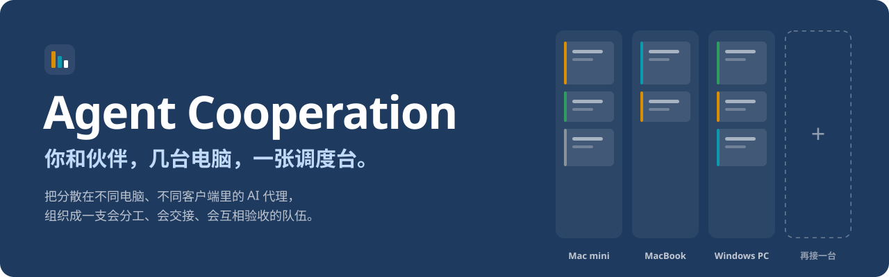
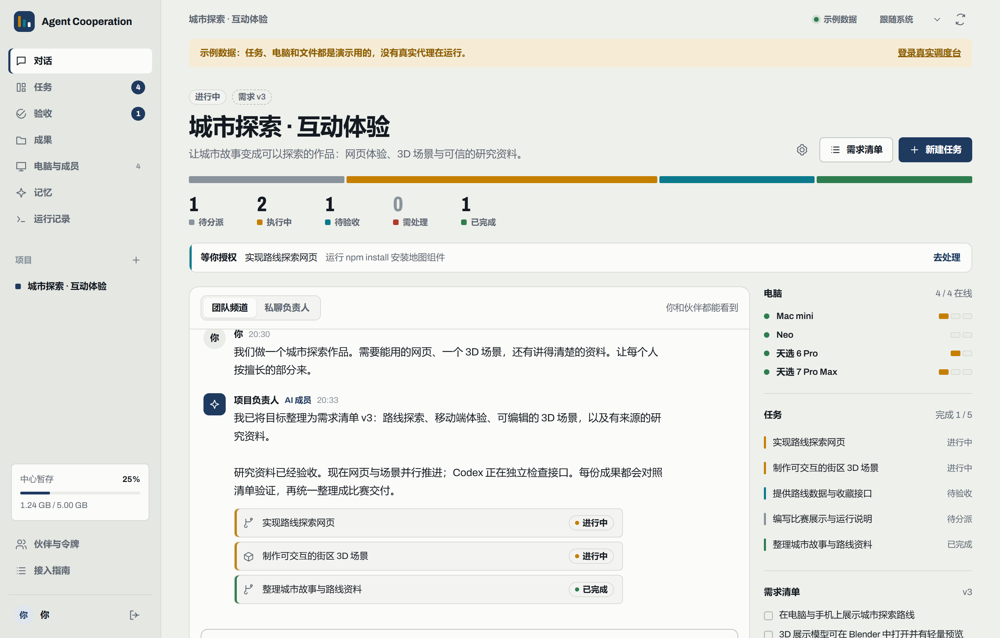
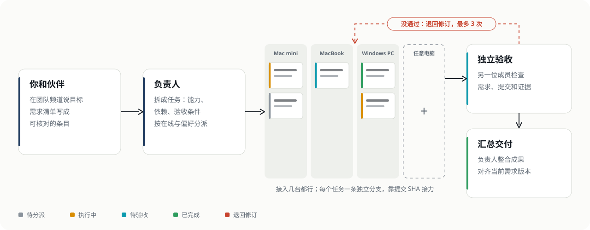

<p align="center">
  
</p>

<p align="center">
  <a href="https://github.com/Jay1023CN/agent-cooperation/releases"></a>
  <a href="LICENSE"></a>
  
  
</p>

<p align="center">
  <b>简体中文</b> · <a href="README.en.md">English</a>
</p>

<p align="center">
  <a href="https://github.com/Jay1023CN/agent-cooperation/releases/tag/v1.16.1">下载 v1.16.1</a> ·
  <a href="#快速开始">开始使用</a> ·
  <a href="#它怎么工作">协作流程</a> ·
  <a href="#能接入哪些客户端">客户端</a> ·
  <a href="#现在做到哪了">进度</a> ·
  <a href="#项目文档">文档</a>
</p>

---

**把几台电脑上的 AI 编程客户端，组织成能分工、交接、独立验收的队伍。**

Claude Code、Codex、Qoder 各自能干活，拆任务、传上下文、核对结果却常常还得靠你。Agent Cooperation 把这些工作集中到一张调度台：你和伙伴说目标，负责人 AI 拆任务，在线电脑上的成员执行，再由另一位成员对照需求和证据验收。

中心自托管，通过 Tailscale 连接其他电脑，无需公网 IP。执行端复用本机客户端及其登录态；DSH 等 harness 的模型、供应商与凭证由它自己的配置决定。

> **当前版本：v1.16.1，仍处于早期。** Windows、Mac 原生包已发布并通过 CI 启动检查；多台真机与真实订阅的完整联调尚未完成。详见[验证状态](#现在做到哪了)。

<table>
  <tr>
    <td width="33%" valign="top"><b>目标变成任务</b><br><sub>负责人写清依赖、文件范围和验收条件，调度记录每次分派的理由。</sub></td>
    <td width="33%" valign="top"><b>按提交交接</b><br><sub>每个任务有独立 Git 分支，依赖固定到提交 SHA，日志与产物一起交回。</sub></td>
    <td width="33%" valign="top"><b>独立验收</b><br><sub>另一位成员核对需求和证据；未通过退回修订，最多自动三次。</sub></td>
  </tr>
</table>

<picture>
  <source media="(prefers-color-scheme: dark)" srcset="docs/images/arena-preview-dark.png">
  
</picture>

<sub>调度台示例数据：任务管线、团队频道、授权请求，以及各台电脑正在执行和排队的任务。截图中的四台电脑仅为示例。</sub>

## 最近更新

- **自动摘要与容量保护**：对话较长时增量整理摘要；中心默认 5 GB，执行目录另有预算，并预留磁盘空间。额度不足时暂停新增工作，已有内容保留。
- **对话存储（v1.16.1）**：新长消息在节省空间时无损压缩，仍能搜索和读取全文。
- **历史找回（v1.15.0）**：按关键词搜索或翻阅较早的对话，个人频道与共享频道分别读取。

- **自动记忆（v1.14.0）**：从对话和反馈中整理偏好与项目约定，支持检索、合并、编辑与删除。
- **桌面协作与 Blender（v1.13.0）**：桌面成员可查询任务进度；Blender 已安装时可检查交付的 `.blend` 产物。

- **任务看板（v1.12.0）**：按状态排列调度车道，以派工单展示任务、成员和授权状态，适配窄屏、深色模式与减少动效。

- **桌面交接修复（v1.11.2）**：会话预检失败后可重试通知；补充消息确认后才能提交候选结果。升级后需重启交接 MCP 进程。

- **电脑与成员页（v1.11.0）**：机器卡片与成员详情重做，在线、客户端检测、忙碌与就绪分别呈现；调度偏好改为可读字段，窄屏与深色主题同步完善。这轮由已有 Claude 桌面会话经 MCP 直接改代码，再由 Codex 测试和验收。

- **连接电脑向导（v1.10.1）**：按系统和安装方式生成启动命令；原生包不再误用 Python。DSH profile、已有会话等字段只在相关客户端显示，成员卡和命令区适配窄屏与深色主题。
- **桌面持续交接（v1.10.0）**：支持定向领取、进度回传、双向消息和提交后接下一单；已有 Claude 会话的本机通知默认关闭，实际领取仍需检查回执。见[桌面交接](docs/desktop-handoff.md)。

- **DSH harness 接入（v1.9.0）**：通过 ACP 创建任务会话，支持自定义 profile、模型选择、权限转交与取消。模型留空时沿用 DSH profile，平台不注入 DeepSeek 官方模型配置。见 [DSH 接入说明](docs/dsh-harness.md)。
- **任务运行记录**：在任务详情里查看执行与独立验收日志，向前翻页加载历史，有新记录时提示刷新。
- **原生包交付**：Windows x64、macOS ARM64 和 Mac 安装助手已发布；GitHub 负责构建、启动检查、哈希校验和附件上传。

[查看 v1.16.1 发布说明](https://github.com/Jay1023CN/agent-cooperation/releases/tag/v1.16.1) · [完整更新记录](CHANGELOG.md)

## 快速开始

### 1. 下载，启动中心

选一台常开的电脑运行中心，其他电脑作为执行端接入。原生包已包含 Python 和网页，运行时无需另装 Python 或 Node.js；代码任务需要 Git，各执行端还需要相应的客户端。

| 电脑 / 用途 | v1.16.1 下载 |
| --- | --- |
| Apple Silicon Mac mini 首次安装 | [Mac 安装助手](https://github.com/Jay1023CN/agent-cooperation/releases/download/v1.16.1/Mac-mini-Setup-v1.16.1.zip) |
| Apple Silicon Mac 手动运行中心或 worker | [macOS ARM64 包](https://github.com/Jay1023CN/agent-cooperation/releases/download/v1.16.1/pal-arena-darwin-arm64-56987255605e.tar.gz) · [SHA-256](https://github.com/Jay1023CN/agent-cooperation/releases/download/v1.16.1/pal-arena-darwin-arm64-56987255605e.tar.gz.sha256) |
| Intel / AMD Windows 电脑 | [Windows x64 包](https://github.com/Jay1023CN/agent-cooperation/releases/download/v1.16.1/pal-arena-windows-amd64-56987255605e.zip) · [SHA-256](https://github.com/Jay1023CN/agent-cooperation/releases/download/v1.16.1/pal-arena-windows-amd64-56987255605e.zip.sha256) |

Mac 安装助手会下载并校验对应版本，配置当前用户登录时自动启动中心。手动安装时，按[交付指南](docs/arena-delivery.md#校验和解压)校验并完整解压，在包的最外层目录运行 `Start Server.command`（Mac）或 `Start Server.cmd`（Windows）。

打开 `http://127.0.0.1:8765`，用 `~/.pal-arena/server/owner-token.txt` 里的令牌登录。Windows 的 `~` 对应当前用户目录。中心数据保存在程序目录之外，升级方式见[交付与升级](docs/arena-delivery.md#升级和回滚)。

### 2. 连接其他电脑

各台电脑安装并登录 Tailscale，在中心的「电脑与成员」页面开启共享，复制生成的 HTTPS 地址。也可以从包的最外层目录执行：

```sh
./pal-arena/pal-arena share
```

Windows 使用 `.\pal-arena\pal-arena.exe share`。首次启用 HTTPS 的步骤见[组网指南](docs/network.md)。中心仍只监听本机回环地址。

### 3. 添加执行成员

在「电脑与成员」里为每台电脑生成专属令牌，选择已安装并配置好的客户端，下载 `worker.json`。在那台电脑的原生包最外层目录运行：

<details>
<summary>Mac 终端命令</summary>

```sh
export ARENA_MACHINE_TOKEN='这台电脑的令牌'
./pal-arena/pal-arena doctor --config worker.json
./pal-arena/pal-arena worker --config worker.json
```

</details>

<details>
<summary>Windows PowerShell 命令</summary>

```powershell
$env:ARENA_MACHINE_TOKEN = '这台电脑的令牌'
.\pal-arena\pal-arena.exe doctor --config worker.json
.\pal-arena\pal-arena.exe worker --config worker.json
```

</details>

`doctor` 不发送模型任务，检查通过也不代表账号或额度可用。先派一个小任务，核对结果、文件与独立验收，再增加成员和并发。令牌文件与后台运行方式见[工作机配置](docs/arena-delivery.md#安装检查和工作机)。

<details>
<summary>源码安装（Python 3.10+）</summary>

```sh
git clone https://github.com/Jay1023CN/agent-cooperation.git
cd agent-cooperation
```

Mac / Linux：

```sh
python3 -m venv .venv
./.venv/bin/python -m pip install -e '.[platform]'
./.venv/bin/python -m arena serve
```

Windows PowerShell：

```powershell
py -3 -m venv .venv
.\.venv\Scripts\python.exe -m pip install -e '.[platform]'
.\.venv\Scripts\python.exe -m arena serve
```

源码安装的执行端使用虚拟环境中的 `python -m arena.worker --config worker.json`。仓库已包含编译后的网页；仅修改前端时需要 Node.js，见[前端说明](frontend/README.md)。

</details>

只想先看界面：登录页点「不登录，先看示例」，或访问 `/?demo=1`。

## 它怎么工作

<picture>
  <source media="(prefers-color-scheme: dark)" srcset="docs/images/flow-dark.svg">
  
</picture>

1. **说目标。** 团队频道你和伙伴都能看到；想先自己理清楚，就私聊负责人，私聊不会改动共享需求。
2. **定需求清单。** 每一条都要能核对，清单有版本号。需求一改，旧版本的验收结果就作废，要重新核对。
3. **拆任务、派任务。** 负责人给每个任务写清能力、依赖、文件范围和验收条件。调度先看硬条件（在线、角色、能力、并发、代码在哪台机器），再按“平衡 / 质量优先 / 省额度”排序，**每次分派都写明理由**。
4. **各台电脑执行。** 执行机主动连接中心领取任务，在独立目录和 `arena/<task>/<attempt>` 分支里干活，交回提交 SHA、日志和产物。依赖任务读的是上一步确定的提交，而不是“大概是最新的代码”。
5. **独立验收。** 验收成员和执行成员不能是同一个；没有结构化结论和证据，就不算通过。不通过退回修订，自动修订最多三次，之后停下来等人处理。
6. **汇总交付。** 全部通过后负责人整合成果，交付必须对齐当前需求版本。合并、部署按项目策略来，比赛的最终提交仍由你们自己完成。

## 适合谁，不适合谁

**适合**：手上有两台以上电脑、已经订了几个 AI 编程客户端、想让它们分工并行又不想自己当调度员的个人或小团队；想自托管、不想把代码和令牌交给第三方云。

**暂时不适合**：
- 只在一台电脑上并行多开 agent（单机场景有更轻的工具，我们的价值在跨电脑和验收）。
- 想要开箱即用的托管服务：这里需要你自己起中心、接电脑。
- 需要生产级稳定性保证：项目还早，真机联调没有完成。

还有几条是刻意的：

- **不假装在线。** 电脑在线、客户端装好了、订阅账号能用，是三个不同状态，界面分开显示。没接入的机器显示空状态，不拿示例数据充数。
- **结果未知就停。** 断线或超时后，不自动重发结果不明的写操作；额度查不到就显示“未知”。
- **记忆会自己积累。** 负责人从日常对话整理长期偏好、背景和项目约定；可以在记忆页查看、编辑、停用或删除，每次任务使用固定版本的记忆。
- **私聊就是私聊。** 个人对话、它的任务、日志和产物只给本人看，不能改共享需求，也不能确认共享交付。

## 用起来顺手的地方

<details>
<summary>展开查看快捷键、通知、GitHub 登录等日常操作</summary>

- **`Ctrl K` / `⌘ K` 一个框走遍全部**：页面、项目、任务、操作（新建任务、连接电脑、切换频道、换主题……）都能搜到，回车执行。
- **键盘就够了**：`N` 新建任务，`/` 直接给负责人发消息，`G` 再按 `C` `T` `R` `F` `M` 跳到对话、任务、验收、成果、电脑。
- **在原地处理卡点**：AI 请求授权时，顶部那条直接点「允许一次」或「拒绝」；失败的任务一键「检查后重试」。
- **页面在后台也不会错过**：开启桌面提醒后，有授权请求或任务失败会弹通知，标签页标题也带数量。
- **链接就是位置**：地址栏记着项目、页面和打开的任务（`#/<项目>/task/<任务>`），发给伙伴、刷新、收藏都会回到同一处；下次打开自动回到上次的项目。
- **装成应用**：浏览器地址栏里「安装」，就像一个独立 App，手机上也能「添加到主屏幕」。
- **命令一键复制**：弹窗里所有命令和 ID 旁边都有「复制」。
- **用 GitHub 登录，用你自己的账号推送**：配置一个 GitHub App 后，成员点「用 GitHub 登录」就能进来；项目设置里选一位成员，任务的提交和推送就以他的账号出现，哪台电脑执行都一样。见 [GitHub 登录](docs/github-login.md)。
- **没有 GitHub App 也能配置推送**：在需要推送代码的电脑上运行 `pal-arena github login --member <成员 ID>`，连接该成员的 GitHub 账号。

</details>

## 能接入哪些客户端

| 客户端 | 接入方式 | 现状 |
| --- | --- | --- |
| Claude Code / Codex / Gemini | 官方 CLI，每个任务新建会话 | 可用；桌面版装了不等于 CLI 装了 |
| Qoder / Qoder CN | ACP 新建会话 | 可用；不接管 IDE 里已打开的聊天 |
| Antigravity | 本机桌面 RPC | 可用；可新建会话，也可接续指定的已有会话 |
| OpenCode | 本机 HTTP 服务 | 可用 |
| DeepSeek Harness（DSH） | ACP，新建任务会话，可指定自己的 profile | v1.9.0 新增；协议测试通过，真实模型路由待联调 |
| 支持 MCP 的桌面客户端 | 各电脑使用独立令牌，由桌面会话主动领取共享任务 | 支持工作区、状态查询、停止和提交验收 |
| GLM 等模型 | 由承载它的客户端选择 | 模型名本身不是可执行程序 |
| Blender | 派给有 Blender 能力的电脑，产出 `.blend` 和导出文件 | 已接入本机打开检查，见 [Blender 任务](docs/arena-blender.md) |

另外保留了上游 PAL 的 `clink` 工具和 [PAL Agent Link](docs/agent-link.md)，可以在 MCP 客户端里调用本机其他代理。

**DSH 接的是 harness。** 模型和供应商在 DSH 中配置，平台不写死 DeepSeek 官方模型。DSH 自带 ACP profile 有自己的初始路由，使用前需配置成你要用的路由；详见 [DSH 接入说明](docs/dsh-harness.md)。

## 现在做到哪了

- [x] 调度台网页：项目、需求版本、团队频道 / 私聊、任务看板、验收、成果、记忆、运行记录，浅色深色跟随系统
- [x] 中心服务：令牌登录、成员与电脑独立凭据、SQLite 存储、5 GB 暂存预算与清理、一致性备份
- [x] 调度：硬条件筛选 + 策略排序 + 分派理由；依赖等前置验收通过才启动
- [x] Git 交接：独立工作目录与分支、提交 SHA 证据、可选推送到 GitHub、发布器整合已验收提交
- [x] 独立验收与最多三次自动修订；结果未知时停止回写，不自动重复执行
- [x] [桌面持续交接](docs/desktop-handoff.md)：定向领取、进度回传、双向消息、提交后接下一单；另有跨电脑任务占用登记
- [x] 用成员本人的 GitHub 账号提交和推送，推送前后双重核对作者
- [x] 用 GitHub 登录工作台；中心续期并按任务下发短期推送凭据
- [x] 一条命令通过 Tailscale 共享中心，网页显示并自动填入地址
- [x] 任务详情中的执行与独立验收日志、历史翻页与新记录提示
- [x] DSH ACP 适配与自定义 profile 配置
- [x] Windows x64 / macOS ARM64 原生包与 Mac 安装助手，GitHub 直接发布附件
- [ ] 多台实机、真实订阅下的端到端联调
- [x] 已有 Claude 桌面会话通过 MCP 真实领取、修改 UI、回传提交，再由 Codex 独立验收（[记录](docs/desktop-handoff.md#真实桌面验证)）
- [x] Blender 项目文件自动打开检查、检查结果与任务证据

本版验证记录：

| 验证项 | 结果与证据 |
| --- | --- |
| GitHub 全量测试 | [1,474 项通过，6 项跳过](https://github.com/Jay1023CN/agent-cooperation/actions/runs/40829652176) |
| 跨平台契约测试 | [Windows / Linux / macOS × Python 3.10 / 3.12，六组通过](https://github.com/Jay1023CN/agent-cooperation/actions/runs/40829652149) |
| 原生包构建与启动 | [Windows、Mac 两端通过，校验后直接发布](https://github.com/Jay1023CN/agent-cooperation/actions/runs/40829978033) |
| 真实 Claude 桌面会话 | [已完成代码交接与独立验收](docs/desktop-handoff.md#真实桌面验证)；可选通知只支持已运行的会话 |

自动化测试使用临时 Git 仓库、假 CLI 和协议夹具，不消耗真实订阅。DSH 真实模型、多机真实订阅的完整任务链路、WorkBuddy 桌面执行和 Blender 实际打开检查仍需实机联调。

## 项目结构

```
arena/         调度台中心服务：API、调度、存储、执行端 worker、维护与发布
frontend/      调度台网页源码（Vite + 原生 JS），构建到 arena/static/
agent_link/    PAL Agent Link：本机客户端适配、桌面交接、跨电脑占用登记
clink/ tools/  上游 PAL MCP 的 CLI 桥接与多模型工具
docs/          说明文档
```

中心与执行端使用 Python，中心 API 为 FastAPI，数据存储为 SQLite；网页是 Vite + 原生 JavaScript，原生包由 PyInstaller 构建。客户端按接口使用 CLI、ACP、MCP 或本机 HTTP / RPC。

改界面从 `frontend/` 开始，见[前端说明](frontend/README.md)。

## 项目文档

| 想做什么 | 文档 |
| --- | --- |
| 安装、连接电脑、升级 | [安装与运行](docs/arena.md) · [交付与升级](docs/arena-delivery.md) · [Tailscale 组网](docs/network.md) |
| 配置客户端与账号 | [DSH harness](docs/dsh-harness.md) · [Agent Link](docs/agent-link.md) · [GitHub 登录与推送](docs/github-login.md) |
| 了解任务规则 | [产品规格](docs/arena-product.md) · [模型分配、记忆与代码交接](docs/arena-routing-memory.md) |
| 维护、备份与恢复 | [维护文档](docs/arena-maintenance.md) · [跨电脑占用记录](docs/coordination.md) |
| 桌面交接和 Blender | [桌面交接](docs/desktop-handoff.md) · [Blender 任务](docs/arena-blender.md) |
| 查看版本变化 | [Release](https://github.com/Jay1023CN/agent-cooperation/releases) · [更新记录](CHANGELOG.md) |

## 来源与许可

基于 [PAL MCP Server](https://github.com/BeehiveInnovations/pal-mcp-server)，遵循 [Apache-2.0](LICENSE)。[Multica](https://github.com/multica-ai/multica) 以子模块引入，使用其自身的 [Multica License](https://github.com/multica-ai/multica/blob/8ffcc88/LICENSE)。
