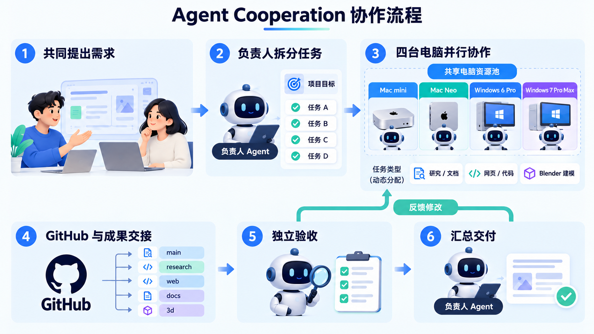

# Agent Cooperation

**把分散在不同电脑和客户端里的 AI 代理，组织成一支能一起做项目的队伍。**

你只需要在工作台说明目标：做一个网站、研究一个问题，或交付一份设计。负责人拆解任务，再交给合适的成员；代码、文档和其他成果都有明确的交接记录，完成后还能安排另一名成员检查。

Agent Cooperation 适合同时使用多台电脑、多个 AI 客户端的个人和小团队。它以 [Multica](https://github.com/multica-ai/multica) 管理项目和任务，以 PAL Agent Link 连接本机代理，让现有工具加入协作。



## 能帮你做什么

- **把大目标拆成可交付的任务**：明确负责人、执行成员、依赖和验收要求，减少反复转述。
- **让不同电脑一起工作**：每台电脑连接自己的运行环境；代码通过独立分支和 Git 提交交接。
- **接入已有客户端**：PAL Agent Link 提供 Qoder、Qoder CN、Antigravity、OpenCode 和 WorkBuddy 等本机连接方式，也保留 PAL 的 `clink` 工具。
- **看见任务和成果**：工作台组织项目、成员和任务；交接时记录工作目录、提交及检查结果，方便接手和复核。


[查看深色界面](docs/images/arena-preview-dark.png)

## 现在可以试什么

项目正在开发中。PAL Agent Link 已提供客户端连接、自检和 Multica 的 MCP 配置生成；PAL Arena 是独立的工作台原型。最新的桌面任务交接原型支持同机领取、提交候选结果和 Git 交付检查，并可选接入跨电脑任务占用登记。

完整的多机自动协作、WorkBuddy 与 Multica 的状态回写，以及真实设备联调仍在开发。交接原型的使用条件和当前边界见[桌面交接说明](docs/desktop-handoff.md)及[跨电脑占用记录](docs/coordination.md)。

## 快速开始

需要 Python 3.10+，并先登录你准备使用的客户端：

```sh
git clone https://github.com/Jay1023CN/agent-cooperation.git
cd agent-cooperation
git submodule update --init third_party/multica
python -m pip install .
python -m agent_link --preflight
python -m agent_link --multica-config
```

自检会检查本机配置与常见命令；最后一条命令生成 MCP 配置。接下来在执行任务的电脑上按 [Multica 接入说明](docs/multica.md)配置代理，先完成一台电脑的连接，再逐步扩展。

想了解各客户端的连接方式，查看 [PAL Agent Link 说明](docs/agent-link.md)；想了解项目方向和进度，查看[整合方案](docs/multica-integration-plan.md)。

## 项目文档

[客户端接入评估](docs/arena-chinese-clients.md) · [模型分配](docs/multica-model-routing.md) · [记忆与代码交接](docs/arena-routing-memory.md) · [更新记录](CHANGELOG.md)

## 来源与许可

本项目基于 [PAL MCP Server](https://github.com/BeehiveInnovations/pal-mcp-server)，遵循 [Apache-2.0 许可证](LICENSE)。[Multica](https://github.com/multica-ai/multica) 以子模块引入，使用其自身的 [Multica License](https://github.com/multica-ai/multica/blob/8ffcc88/LICENSE)。
